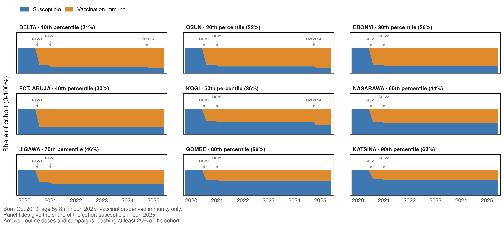
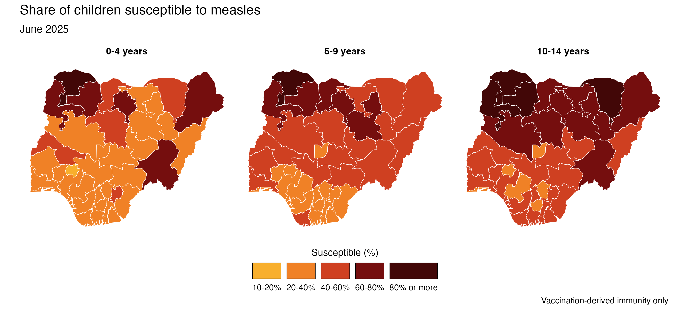

# mipR 

<!-- badges: start -->

[](https://lifecycle.r-lib.org/articles/stages.html#experimental)

<!-- badges: end -->

**Spatiotemporal Measles Population Immunity Profiling**

`mipR` is an R package for reconstructing and projecting measles population immunity by birth cohort, geographical area and calendar month.

It combines historical routine vaccination coverage, supplementary immunisation activities (SIAs), population estimates and vaccine effectiveness to estimate vaccination-derived immunity and susceptibility over time.

The package supports subnational assessments of immunity gaps and planning of measles vaccination campaigns.

## Why mipR?

Current vaccination coverage does not describe the immunity of an entire population. Immunity depends on the vaccination opportunities available to each birth cohort, the proportion vaccinated and vaccine effectiveness.

These factors vary by age, geographical area and calendar period. Reconstructing historical vaccination opportunities helps identify where susceptible populations have accumulated.

`mipR` allows analysts to examine:

- geographical differences in vaccination-derived susceptibility
- immunity gaps across birth cohorts and age groups
- changes in susceptibility over time
- the effects of alternative routine coverage and campaign assumptions on estimated immunity

## What mipR does

| Component                                         | Functions                                                                                                                                                                                                                              |
| ------------------------------------------------- | -------------------------------------------------------------------------------------------------------------------------------------------------------------------------------------------------------------------------------------- |
| **Population, vaccination and boundary data**     | `get_boundaries()`, `list_boundaries()` (OCHA, geoBoundaries, GADM, WHO); `get_worldpop()`, `get_worldpop_single_age()`; `get_ihme_mcv()`, `read_ihme_mcv_admin()`; `get_demog_wpp()` (UN WPP 2024 rates, age structure and mortality) |
| **Population-weighted raster extraction**         | `extract_raster()`, with population weighting and year matching for raster stacks                                                                                                                                                      |
| **Monthly birth cohort reconstruction**           | `reconstruct_birth_cohorts()`, monthly birth cohorts calibrated to annual population estimates                                                                                                                                         |
| **Campaign data preparation**                     | `prepare_campaigns()`, standard campaign records, survey indicators and diagnostics                                                                                                                                                    |
| **Vaccination histories and immunity estimation** | `build_vaccination_history()`, `estimate_immunity()`, `ve_cdc()`, `summarise_immunity()`                                                                                                                                               |
| **Survey comparisons and uncertainty**            | `check_immunity()` against post-campaign surveys; `immunity_draws()` from coverage bounds                                                                                                                                              |
| **Cohort plots and immunity maps**                | `plot_cohort_journey()`, `plot_cohort_protection()`, `map_immunity()`, `get_palette()`, `save_plot()`                                                                                                                                  |

Infection-acquired immunity and dedicated scenario-comparison functions are planned. Alternative vaccination scenarios can currently be evaluated by changing routine coverage or campaign inputs and rerunning the immunity calculations.

A worked state-level example for Nigeria is provided in [`examples/nga_pipeline.R`](examples/nga_pipeline.R). Campaign inputs are prepared in [`examples/nga_campaign_data.R`](examples/nga_campaign_data.R).

## Small reproducible example

This example needs no downloads. It spreads a population anchor of 365 children evenly across birth dates, without mortality adjustment, and applies 80% MCV1 coverage at nine months.

```r
population <- dplyr::tibble(
  adm1 = "Example", year = 2024, age = 0, pop = 365
)
cohorts <- mipR::reconstruct_birth_cohorts(
  population, geography = "adm1", method = "uniform", end = "2024-12"
)
coverage <- dplyr::tibble(
  adm1 = "Example", year = 2023:2024, dose = "mcv1", coverage = 0.8
)
schedule <- dplyr::tibble(dose = "mcv1", age_months = 9)
history <- mipR::build_vaccination_history(
  cohorts, coverage, schedule = schedule, geography = "adm1"
)
immunity <- mipR::estimate_immunity(history, cohorts)
mipR::summarise_immunity(immunity, at = "2024-12")
```

The constrained reconstruction method fits population anchors robustly; it does not guarantee exact agreement with every annual estimate. Inspect `anchor_check` for remaining differences. The fitting tolerance must be positive; a zero tolerance is supported only by the uniform and survival methods.

## Example: Nigeria

The Nigeria example reconstructs monthly birth cohorts, applies routine and campaign vaccination histories, and estimates vaccination-derived immunity at state level.

The code below illustrates a shorter period, starting in 2010; the full script starts in 2000. It uses four prepared inputs:

- `aged_pop_admin`: state-level population by single year of age, extracted from WorldPop
- `routine_coverage`: annual IHME MCV1 and MCV2 coverage estimates by state
- `campaigns`: campaign records prepared using `prepare_campaigns()`
- `schedule`: the national routine schedule, with the age at each dose

The complete workflow is available in [`examples/nga_pipeline.R`](examples/nga_pipeline.R).

```r
shp <- mipR::get_boundaries(country = "NGA", adm_level = 1, source = "who")
demog <- mipR::get_demog_wpp(country = "NGA", year = 2010:2030)

# monthly birth cohorts by state
cohorts <- mipR::reconstruct_birth_cohorts(
  aged_pop_admin,
  geography = c("adm0", "adm1", "adm1_code"),
  population = "pop",
  ref_date = "ref_date",
  method = "constrained",
  mortality = demog$mortality,
  births = demog$rates,
  start = "2010-01",
  end = "2025-12"
)

# routine and campaign doses each cohort was eligible for
history <- mipR::build_vaccination_history(
  cohorts,
  routine_coverage = routine_coverage,
  campaigns = campaigns,
  schedule = schedule,
  geography = c("adm0", "adm1", "adm1_code")
)

immunity <- mipR::estimate_immunity(history, cohorts, coupling = "dependent")
summary_2025 <- mipR::summarise_immunity(immunity, at = "2025-06")

mipR::map_immunity(summary_2025, shp, type = "bins", ncol = 4)
mipR::plot_cohort_journey(
  immunity, birth = "2019-10", at = "2025-06", label = "adm1"
)
```

`plot_cohort_journey()` shows how immunity changes from birth for a selected cohort. States are selected across percentiles of susceptibility, with routine vaccination and campaign opportunities marked along the timeline.



`map_immunity()` displays estimated susceptibility by state and age group.



These figures use population from 2010 onwards and include vaccination-derived immunity only.

## Methodological approach

### The CDC immunity profile method

`mipR` implements the vaccination-based population immunity profiling method described by Li, Goodson and Perry (2024).

The method estimates immunity for each birth cohort by applying routine vaccination and campaign coverage sequentially, accounting for vaccine effectiveness and previous vaccination.

For MCV1 coverage $`C_1`$ and effectiveness $`E_1`$, the immune proportion after the first dose is:

```math
I_1 = C_1 E_1
```

With MCV2 coverage $`C_2`$ and effectiveness $`E_2`$, the immune proportion after the second dose is:

```math
I_2 =
\begin{cases}
I_1 + (C_1 - I_1)\,\dfrac{C_2}{C_1}\,E_2 & \text{if } C_2 < C_1 \\[6pt]
I_1 + (C_1 - I_1)\,E_2 + (C_2 - C_1)\,E_2 & \text{if } C_2 \ge C_1
\end{cases}
```

The proportion receiving at least one dose is $`V = \max(C_1, C_2)`$. For each subsequent campaign $`k`$, with coverage $`S_k`$ and effectiveness $`E_k`$, immunity is updated as follows:

```math
I \leftarrow
\begin{cases}
I + (V - I)\,\dfrac{S_k}{V}\,E_k & \text{if } S_k < V \\[6pt]
I + (S_k - I)\,E_k, \quad V \leftarrow S_k & \text{if } S_k \ge V
\end{cases}
```

The susceptible proportion is $`1 - I`$.

The default dependent vaccination assumption prioritises previously vaccinated children over those who have received no doses. This is the assumption of the original method. `estimate_immunity()` also supports independent and complementary allocation through its `coupling` argument.

Vaccine effectiveness varies by dose and age at vaccination. The values implemented in `ve_cdc()` are:

- MCV1 and campaign doses below 9 months: 0.58
- MCV1 and campaign doses at 9–11 months: 0.84
- From 12 months: 0.925 for MCV1 and 0.95 for campaign doses
- MCV2: 0.95

### Spatiotemporal implementation

`mipR` extends the cohort-based vaccination calculations across geographical areas and monthly birth cohorts. Immunity and susceptibility are estimated for each calendar month.

**Notation.** $`g`$ is a geography, $`c`$ a monthly birth cohort covering the birth dates $`[b_c, b_{c+1})`$, $`t`$ a calendar month and $`k`$ a vaccination opportunity. Monthly estimates are referenced to the 15th day of each month.

**Population.** The population of cohort $`c`$ in geography $`g`$ and month $`t`$ is

```math
N_{g,c,t} = B_{g,c}\,\ell_c(t)
```

where $`B_{g,c}`$ is the number of births and $`\ell_c(t)`$ the share surviving to month $`t`$, from UN WPP single-age mortality. `reconstruct_birth_cohorts()` estimates $`B_{g,c}`$ from annual population estimates $`P_{g,a,y}`$ (for example WorldPop) by single year of age $`a`$. Annual age-specific population estimates are allocated across the corresponding birth months and adjusted for survival. The births are fitted so that

```math
\sum_{c \in C(a,y)} B_{g,c}\,\ell_c(t_y)\,w_{c,a,y} \approx P_{g,a,y}
```

Here $`C(a,y)`$ are the cohorts aged $`a`$ on the reference date $`t_y`$, and $`w_{c,a,y}`$ is the share of cohort $`c`$ inside that age. The tolerance controls robust fitting weights rather than imposing an exact constraint. Inconsistent population estimates receive lower weights. Remaining differences are reported in `anchor_check`.

**Eligibility.** Births are assumed to be uniformly distributed across days within each month. The share of cohort $`c`$ eligible for opportunity $`k`$ is the share of its birth dates $`d`$ whose age is in the target range at some time during the opportunity:

```math
e_{c,k} = \frac{1}{|D_c|} \sum_{d \in D_c}
\mathbf{1}\!\left[\,\text{age}_d \in [a^{\min}_k, a^{\max}_k)
\text{ during } k\,\right]
```

so a cohort born in January becomes eligible for MCV1 at 9 months over the days of October, and a campaign reaches only the part of a cohort inside its target ages.

**Coverage.** Estimated coverage for each cohort and vaccination opportunity $`k`$ is

```math
r_{g,c,k} = \text{coverage}_{g,k} \times e_{c,k}
```

with routine coverage for the calendar year of the dose (IHME, by geography) and campaign coverage from post-campaign surveys, or coverage reported by the campaign where no survey exists.

**State.** Each birth-day group is represented by proportions in vaccination and protection states $`s = (\text{doses}, \text{MCV1 received}, \text{protected})`$. Coverage is allocated within eligible birth-day groups according to the specified vaccination-dependence assumption. MCV2 prioritises MCV1 recipients; the dependent rule (the CDC default) prioritises children with any previous dose over those with none. Reached children who are not protected become protected with probability $`E_k`$, evaluated at their age on the dose date. With full eligibility and fixed vaccine effectiveness, the transitions reproduce the Figure 1 formulas above.

**Monthly values.** Vaccination states are evaluated using only the doses received by the 15th. Birth-day groups retain their eligibility and vaccination history; the reported monthly cohort is their weighted mean:

```math
\pi_{g,c}(t) = \frac{1}{|D_c|} \sum_{d \in D_c} \pi_{g,d}(t)
```

A later opportunity cannot change an earlier report. Campaign timing and coverage remain model assumptions; the history metadata documents the rules applied. Check these against the campaign records before interpreting monthly changes.

**Susceptible population.** The susceptible count in each geography, cohort and month is

```math
U_{g,c,t} = N_{g,c,t} \sum_{s:\,\text{not protected}} \pi_{g,c}(s, t)
```

and `summarise_immunity()` adds $`U_{g,c,t}`$ and $`N_{g,c,t}`$ over the cohorts in each age band. Infants younger than 6 months are flagged as protected by maternal antibodies and left out of summaries by default; their state proportions are not changed. Immunity from infection is not yet included.

The default exclusion of infants under six months also removes them from the population denominator: the first age band therefore describes the remaining infants, rather than all children under one.

**Uncertainty.** `immunity_draws()` propagates uncertainty in routine and campaign coverage through repeated immunity calculations. A logit-normal approximation uses each point estimate and interval width; its quantiles need not equal asymmetric supplied bounds. Routine draws are correlated across years and between MCV1 and MCV2. The resulting intervals represent coverage uncertainty only. They exclude uncertainty in population, vaccine effectiveness and model structure.

## Installation

`mipR` is currently under development and is not available on CRAN.

The development version can be installed from GitHub using:

```r
pak::pak("truenomad/mipR")
```

Population inputs need the optional `wpp2024` package. Maps need `ggplot2` and `sntutils`; `mirai` enables parallel uncertainty draws. Install these optional packages for the complete workflow:

```r
pak::pak(c("PPgp/wpp2024", "ggplot2", "ahadi-analytics/sntutils", "mirai"))
```

The synthetic example above uses the core dependencies only. The Nigeria scripts also require `here`, `pdftools`, `stringr` and `tibble`.

## Development status

`mipR` is under active development. The functions documented above are implemented and tested, but their interfaces may change before the first release.

## Reference

`mipR` builds on the population immunity profiling method described by:

Li X, Goodson JL, Perry RT (2024). [Measles Population Immunity Profiles: Updated Methods and Tools](https://doi.org/10.3390/vaccines12080937). _Vaccines_, **12**(8), 937.

`mipR` is independently developed and is not affiliated with or endorsed by the US Centers for Disease Control and Prevention.

## Citation

A software citation will be provided with the first release.

Once available, citation information can be retrieved using:

```r
citation("mipR")
```

## Licence

`mipR` is distributed under the MIT licence. See [LICENSE.md](LICENSE.md).
